# App Factory Module Generator & Integrator Guide

This comprehensive, step-by-step guide explains how to define, scaffold, integrate, and verify new domain modules in the **App Factory Backend Starter Kit** using specification-driven automation.

---

## Architecture Lifecycle Overview

The module development workflow follows a strict, repeatable lifecycle designed to minimize manual boilerplate while guaranteeing architectural consistency, security, and test isolation:

```mermaid
flowchart LR
    A["1. JSON Spec<br/>(specs/products.json)"] --> B["2. Generator<br/>(npm run generate:module)"]
    B --> C["3. Generated Files<br/>(src/modules/products/)"]
    C --> D["4. Integrator<br/>(npm run integrate:module)"]
    D --> E["5. Migration Review<br/>(npm run db:generate)"]
    E --> F["6. Safe Migration<br/>(npm run db:migrate)"]
    F --> G["7. Verification & Tests<br/>(npm test)"]
    G --> H["8. Running API<br/>(/api/v1/products)"]
```



---

## Step 1: Install Dependencies & Setup Environment

Before generating modules, clone the repository, install dependencies, and configure your local environment.

```bash
# 1. Clone repository and navigate to root directory
cd D:\App-factory(starter-kit)

# 2. Install all dependencies
npm install

# 3. Create .env from template if not already present
cp .env.example .env
```

Ensure `.env` contains valid values for:
- `DATABASE_URL`: PostgreSQL connection string (development/test database).
- `JWT_SECRET`: Random 32+ character secret string.
- `PORT`: (Default: `3000`).

---

## Step 2: Create a JSON Module Specification

Specifications live under `./specs/` and define the module name, description, field attributes, operations, and pagination behavior.

Create `./specs/products.json`:

```json
{
  "name": "products",
  "description": "Product catalog domain module for App Factory inventory management",
  "fields": [
    {
      "name": "name",
      "type": "string",
      "required": true,
      "description": "Product display name"
    },
    {
      "name": "price",
      "type": "number",
      "required": true,
      "description": "Retail price in USD"
    },
    {
      "name": "description",
      "type": "string",
      "required": false,
      "description": "Optional extended product summary"
    },
    {
      "name": "inStock",
      "type": "boolean",
      "required": true,
      "description": "Inventory stock availability flag"
    },
    {
      "name": "releasedAt",
      "type": "date",
      "required": false,
      "description": "Product launch timestamp"
    }
  ],
  "operations": ["create", "read", "update", "delete"],
  "pagination": true
}
```

### Specification Field Reference

| Property | Type | Default | Description |
| :--- | :--- | :--- | :--- |
| `name` | `string` | *(Required)* | Module name in camelCase, PascalCase, snake_case, or kebab-case (e.g., `products`, `guideDemoProducts`, `order-items`). |
| `description` | `string` | Optional | Human-readable documentation for OpenAPI and Swagger schemas. |
| `fields` | `array` | *(Required)* | List of domain fields (minimum 1 field). |
| `fields[].name` | `string` | *(Required)* | Field identifier (must start with letter, alphanumeric/underscore). |
| `fields[].type` | `string` | *(Required)* | Supported types: `'string'`, `'number'`, `'boolean'`, `'date'`. |
| `fields[].required` | `boolean` | `true` | If `true`, mapped to non-null column and required in Zod create schema. |
| `fields[].description`| `string` | Optional | OpenAPI description for the field property. |
| `operations` | `array` | `['create', 'read', 'update', 'delete']` | CRUD capabilities enabled for the route plugin. |
| `pagination` | `boolean` | `true` | Enables cursor-based and offset-limit pagination schemas and utilities. |

---

## Step 3: Generate the Module Scaffolding

Run the generator using either a specification file or direct CLI flags.

### Option A: From Specification File (Recommended)

```bash
# Validate and preview without writing to disk
npm run generate:module -- --spec ./specs/products.json --dry-run

# Generate files to src/modules/products/
npm run generate:module -- --spec ./specs/products.json
```

### Option B: From Command-Line Arguments

```bash
npm run generate:module -- products --fields name:string,price:number,inStock:boolean,description:string:optional
```

### Generated Files Explained

The generator creates 6 production-ready files inside `src/modules/<kebab-name>/`:

| File | Purpose |
| :--- | :--- |
| `<name>.schema.ts` | Drizzle PostgreSQL table definition (`pgTable`), Zod validation schemas (`create`, `update`, `idParam`, `pagination`), and TypeScript type exports. |
| `<name>.repository.ts` | Data-access queries with strict tenant isolation (`userId` enforcement), soft-delete filtering (`isNull(deletedAt)`), and cursor/offset retrieval. |
| `<name>.service.ts` | Business logic, response mapper (`toResponse`), and pagination packaging (`buildCursorPagination`, `buildLimitOffsetPagination`). |
| `<name>.routes.ts` | Fastify route plugin with route-level `authGuard`, OpenAPI 3.0 annotations, input validation, and standardized JSON response envelopes (`ok`, `fail`). |
| `index.ts` | Public barrel file re-exporting schema, repository, service, and routes. |
| `<name>.test.ts` | Vitest integration test suite testing authentication guards (401), validation (400), creation (201), and non-existent resource handling (404). |

> [!NOTE]
> Generating files creates them inside `src/modules/<module-name>/`. The module is **not yet connected** to the application until you run the integrator in Step 4.

---

## Step 4: Integrate the Module Automatically

The integrator automatically connects your generated module into the App Factory core substrate:

```bash
# Dry-run: preview diffs without touching any files on disk
npm run integrate:module -- --name products --dry-run
# Or by specification:
npm run integrate:module -- --spec ./specs/products.json --dry-run

# Apply changes automatically with TypeScript compilation check
npm run integrate:module -- --name products --yes
# Or:
npm run integrate:module -- --spec ./specs/products.json --yes
```

### What Files Are Updated?

1. **`src/db/schema.ts`**: Re-exports the Drizzle table so `drizzle-kit` detects it for migrations:
   ```typescript
   export { products } from '../modules/products/index.js';
   ```
2. **`src/routes/apiV1.ts`**: Imports and registers the Fastify route plugin:
   ```typescript
   import { productsRoutes } from '../modules/products/index.js';
   // inside apiV1Routes:
   await app.register(productsRoutes);
   ```
3. **`tests/setup.ts`**: Adds the PostgreSQL table name (snake_case) to the isolated test truncation list:
   ```typescript
   const appTables = ['examples', 'categories', 'products', 'user_sessions', 'users'];
   ```

### Safety & Idempotency Guarantees
- **Non-destructive**: Checks if exports and registrations exist before writing.
- **Repeatable**: Running `integrate:module` multiple times produces zero duplicate edits.
- **Atomic Rollback**: If TypeScript validation (`tsc --noEmit`) fails after patching, all files are immediately restored to their original state.

---

## Step 5: Generate and Review Database Migration

After the schema export is registered, generate the PostgreSQL migration file using Drizzle Kit:

```bash
npm run db:generate
```

### Reviewing the Generated Migration
Open the newly created SQL file in `drizzle/` (e.g. `drizzle/0004_....sql`):
1. Confirm the `CREATE TABLE "<table_name>"` statement matches your expected column definitions and types.
2. Confirm the foreign key constraint `REFERENCES "public"."users"("id") ON DELETE cascade`.
3. Confirm the tenant-isolation indexes on `user_id` and `created_at`.

> [!IMPORTANT]
> Never skip reviewing the generated SQL before applying it to any persistent database.

---

## Step 6: Apply the Migration Safely

Apply pending migrations to your **development** database:

```bash
npm run db:migrate
```

### Migration Safety Rules
- 🛑 **Never run `db:migrate` against an unverified or production database** without explicit backup verification, change approval, and deployment staging.
- 🛑 **Never edit or delete migration files** once they have been applied or committed.
- ✅ Automated tests **do not require** running `db:migrate` manually: `tests/globalSetup.ts` automatically executes unapplied migrations inside an isolated test schema (`app_test`).

---

## Step 7: Verify the Module

Verify code quality, compilation, and test execution using the standard npm lifecycle scripts:

```bash
# 1. Type-check (compilation verification without emitting files)
npm run type-check

# 2. Linting (ESLint)
npm run lint

# 3. Run the new module's integration tests
npx vitest run src/modules/products/products.test.ts

# 4. Run the complete test suite
npm test
```

---

## Step 8: Test the Live API

Start the local development server:

```bash
npm run dev
# Server listening on http://localhost:3000
```

Explore interactive OpenAPI documentation:
- **Swagger UI**: `http://localhost:3000/docs`
- **OpenAPI JSON**: `http://localhost:3000/docs/json`

### End-to-End API Walkthrough

#### 1. Register a Test User
```bash
curl -X POST http://localhost:3000/api/v1/register \
  -H "Content-Type: application/json" \
  -d '{"email":"dev@example.com","password":"Password123!","name":"Dev User"}'
```
*Save the returned `token` (JWT).*

#### 2. Create a Product (`POST /api/v1/products`)
```bash
curl -X POST http://localhost:3000/api/v1/products \
  -H "Content-Type: application/json" \
  -H "Authorization: Bearer <YOUR_ACCESS_TOKEN>" \
  -d '{
    "name": "Wireless Ergonomic Mouse",
    "price": 49.99,
    "inStock": true,
    "description": "Ergonomic 2.4GHz wireless mouse with optical tracking"
  }'
```

**Response (HTTP 201 Created)**:
```json
{
  "success": true,
  "data": {
    "id": "e6a18d22-1b3c-4d5e-8f90-123456789abc",
    "userId": "c5f11200-88aa-41bb-b4c9-9876543210aa",
    "name": "Wireless Ergonomic Mouse",
    "price": 49.99,
    "inStock": true,
    "description": "Ergonomic 2.4GHz wireless mouse with optical tracking",
    "releasedAt": null,
    "createdAt": "2026-10-28T19:50:00.000Z",
    "updatedAt": "2026-10-28T19:50:00.000Z"
  }
}
```

#### 3. List Products with Cursor Pagination (`GET /api/v1/products`)
```bash
curl -X GET "http://localhost:3000/api/v1/products?limit=10" \
  -H "Authorization: Bearer <YOUR_ACCESS_TOKEN>"
```

**Response (HTTP 200 OK)**:
```json
{
  "success": true,
  "data": [ ... ],
  "meta": {
    "hasMore": false,
    "nextCursor": null
  }
}
```

#### 4. Get Product by ID (`GET /api/v1/products/:id`)
```bash
curl -X GET http://localhost:3000/api/v1/products/e6a18d22-1b3c-4d5e-8f90-123456789abc \
  -H "Authorization: Bearer <YOUR_ACCESS_TOKEN>"
```

#### 5. Update Product (`PUT /api/v1/products/:id`)
```bash
curl -X PUT http://localhost:3000/api/v1/products/e6a18d22-1b3c-4d5e-8f90-123456789abc \
  -H "Content-Type: application/json" \
  -H "Authorization: Bearer <YOUR_ACCESS_TOKEN>" \
  -d '{"price": 39.99}'
```

#### 6. Delete Product (`DELETE /api/v1/products/:id`)
```bash
curl -X DELETE http://localhost:3000/api/v1/products/e6a18d22-1b3c-4d5e-8f90-123456789abc \
  -H "Authorization: Bearer <YOUR_ACCESS_TOKEN>"
```

---

## Step 9: Troubleshooting Common Failures

### 1. `Specification validation failed: fields: Module specification must contain at least one field definition.`
- **Cause**: The JSON specification has an empty `fields` array.
- **Fix**: Define at least one field with `name` and `type`.

### 2. `Unsupported field type "xyz" for field "fieldName".`
- **Cause**: Specification specified an unsupported type.
- **Fix**: Use only supported types: `'string'`, `'number'`, `'boolean'`, or `'date'`.

### 3. `Module directory "..." already exists. Use --force to overwrite existing files.`
- **Cause**: Safeguard preventing accidental overwrites of existing developer implementations.
- **Fix**: Review existing files. If you intend to overwrite, pass `--force`:
  ```bash
  npm run generate:module -- --spec ./specs/products.json --force
  ```

### 4. `Required module file "<name>.routes.ts" is missing in "...". Cannot integrate an incomplete module.`
- **Cause**: Attempted to integrate a deleted or partially generated module directory.
- **Fix**: Re-run the generator with `--force` to recreate the missing module files before integrating.

### 5. `TypeScript verification failed after integration. Changes were rolled back.`
- **Cause**: Compiler error caused by missing type definitions or conflicting symbols.
- **Fix**: The integrator automatically reverted all files to their pristine state. Run `npm run type-check` to view the underlying issue in the module source code before re-attempting.

### 6. `error: unsupported startup parameter in options: search_path`
- **Cause**: Connecting through a PgBouncer transaction-mode pooler (e.g. Neon `-pooler` endpoint) which disallows startup parameters.
- **Fix**: Use direct PostgreSQL connection URL in `.env` (remove `-pooler` from hostname) or allow the built-in Starter Kit connection layer to resolve the direct endpoint automatically.

### 7. `Safety check failed: connected to 'public' schema.`
- **Cause**: Vitest test runner detected connection to `public` schema.
- **Fix**: Tests are strictly isolated in `app_test`. Verify `TEST_DB_SCHEMA=app_test` in `.env`.

### 8. `Foreign key constraint violation on user_id`
- **Cause**: Generated queries or tests attempted to insert a domain resource without a valid `users.id`.
- **Fix**: The starter kit requires an authenticated user. In tests, use `registerTestUser()` helper to create a valid tenant user before issuing requests.

